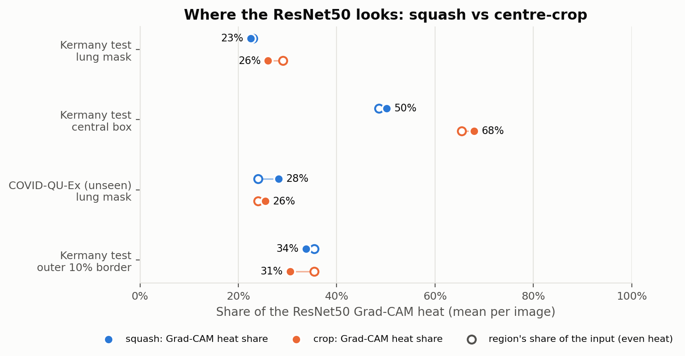
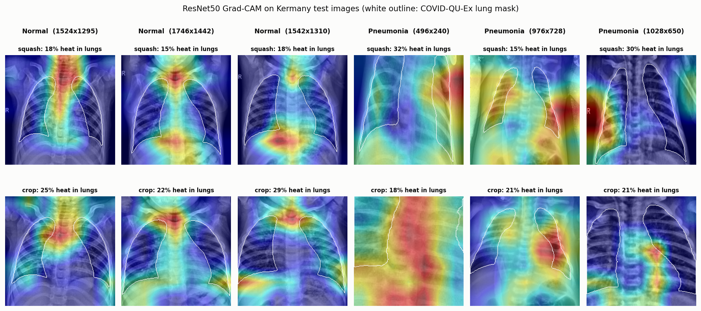

# Centre-crop ablation: does removing the aspect-ratio shortcut change the results?

**Question.** Kermany pneumonia X-rays are natively smaller and wider than normal ones. Width, height and aspect ratio alone predict the label with test ROC-AUC 0.912. The default pipeline squashes every image to 224x224, which bakes the aspect ratio into the anatomy. This ablation removes the squash by taking the central square before resizing, then retrains and compares.

## Short answer

1. **Accuracy drops a little.** ResNet50 falls from 95.7% to 93.7% on the same 583 test images (-2.1 points, 95% CI -4.0 to -0.4, McNemar p = 0.036). ROC-AUC goes from 0.993 to 0.989, and missed pneumonias rise from 13 to 24.
2. **The size shortcut is not removed; it moves.**
   - The crop's native side length alone still predicts the label with AUC 0.912, the same as the full Review-I probe.
   - Where the lungs sit in the cropped model input predicts the label with AUC 0.927 (0.937 for squash), without looking at any pixel.
3. **Grad-CAM does not move onto the lungs.** ResNet50's share of heat inside the lungs rises from 22.5% to 26.1%, but only because the lungs fill more of the cropped frame (22.9% to 29.0% of the input). In both pipelines the heat is spread about as evenly as the lung area. The one clear change: on pneumonia images, the border band's share of heat drops from 38% to 30% (the band covers 35% of the input), so cropping stops the extra weight on borders and side markers.
4. **Unseen COVID-QU-Ex: no gain for ResNet50, a large gain for the baseline.** ResNet50 stays at 73.9% vs 74.0% (AUC 0.873 vs 0.850). The baseline CNN rises from 55.5% to 75.3%, because the squashed baseline called almost every unseen image pneumonia (specificity 0.14, against 0.71 after cropping).

**Verdict.** The aspect-ratio squash is not what makes the models score well on Kermany, and removing it does not make the ResNet50 generalise better or look more at the lungs. The shortcut is wider than the aspect ratio. Native resolution and how the lungs are framed (collimation) also differ by class, and a centre crop leaves both in place. The crop even creates a new cue: in wide pneumonia images the crop cuts into the lungs (it keeps a median 93.5% of them), so their lungs touch the frame edge. The default squash pipeline stays the default. The crop is kept as an option (`XRAY_PREPROCESS=crop`).

## Setup

| | Default (`squash`, all Review-I/II results) | Ablation (`crop`) |
|---|---|---|
| Geometric step | whole image resized to 224x224 (aspect ratio lost) | central square (side = shorter edge) resized to 224x224 |
| Everything else | grayscale -> INTER_AREA -> CLAHE (2.0, 8x8) -> RGB | identical |
| Splits | `splits/binary` | `splits/ablation_crop/binary`: same 4,658 / 583 / 583 images and patients (checked file by file) |
| Training | `src.train --task binary`, seed 42 | identical command with `XRAY_PREPROCESS=crop` |
| Outputs | `results/`, `models/` | `results/ablation_crop/`, `models/ablation_crop/` |

The variant lives in one function, `fit_to_input` in `src/data/preprocessing.py`. Data preparation, training, Grad-CAM and the API all use it. A trained model records its variant in `class_names.json`, and the API applies that variant. Older models have no variant field and get `squash`. On validation F1, both pipelines select ResNet50: 0.962 for squash, 0.954 for crop.

## 1. Test metrics (held-out Kermany test split, n = 583)

| Model | Preprocessing | Accuracy (95% CI) | Sensitivity | Specificity | F1 | ROC-AUC | FP | FN |
|---|---|---|---|---|---|---|---|---|
| ResNet50 | squash | 95.7% (93.7-97.1) | 0.969 | 0.924 | 0.971 | 0.993 | 12 | 13 |
| ResNet50 | crop | 93.7% (91.4-95.4) | 0.944 | 0.918 | 0.956 | 0.989 | 13 | 24 |
| Baseline CNN | squash | 94.2% (92.0-95.8) | 0.988 | 0.817 | 0.961 | 0.986 | 29 | 5 |
| Baseline CNN | crop | 89.7% (87.0-91.9) | 0.861 | 0.994 | 0.924 | 0.990 | 1 | 59 |

Paired on the same images (crop minus squash; CIs from 2,000 patient-level bootstrap resamples):

| Model | Accuracy change | Only squash right / only crop right | McNemar p | ROC-AUC change | Same prediction |
|---|---|---|---|---|---|
| ResNet50 | -2.1 points (-4.0 to -0.4) | 20 / 8 | 0.036 | -0.005 (-0.010 to 0.000) | 95.2% |
| Baseline CNN | -4.5 points (-7.6 to -1.2) | 54 / 28 | 0.005 | +0.004 (-0.001 to +0.009) | 85.9% |

The baseline's ranking is as good as before (AUC 0.990). Its loss is a threshold shift: almost no false alarms, but 59 missed pneumonias at the 0.5 cut-off.

For ResNet50, viral pneumonia suffers most: accuracy falls from 94.6% to 89.9% (bacterial 98.2% to 96.7%, normal 92.4% to 91.8%). The 14 pneumonia images only the crop model misses are the **narrow** ones: median aspect ratio 1.32, against 1.51 for the pneumonias both models get right (Mann-Whitney p = 0.0007). Their lungs are also the least cut by the crop (97% kept vs 92%, p = 0.02). So the cropped model misses pneumonias whose framing looks normal. With n = 14, this is a lead, not a proof.

## 2. Size-only probes

Logistic regression on geometry only, no pixels, trained on the train split and scored on the test split (`comparison/size_probe.md`):

| Features | Test ROC-AUC |
|---|---|
| Native width + height + aspect ratio (Review-I probe, reproduced) | 0.912 |
| Aspect ratio only: the cue squash keeps as distorted anatomy and crop removes | 0.861 |
| Crop side only: all the size information left after cropping | **0.912** |
| Lung area + lung bounding box in the squash model input | 0.937 |
| Lung area + lung bounding box in the crop model input | 0.927 |

The lung features come from 4,130 train and 517 test images that have a lung mask (section 3).

Per feature (`comparison/lung_framing.md`), the strongest single cue is the **top edge of the lungs**. In pneumonia images the lungs start higher in the frame: at 10.7% of the input height, against 17.4% for normal images. That gives AUC 0.887, the same in both pipelines, because a centre crop of a wide image keeps the full height. The crop then adds cues of its own:
- the lungs touching the left edge of the frame (AUC 0.777);
- the share of the lungs the crop keeps: median 100% for normal and 93.5% for pneumonia (AUC 0.828).

After cropping, the native resolution survives only as the resampling factor (224 / crop side). Whether the CNN uses it is not measured here.

## 3. Grad-CAM heat inside the lungs

For each image, I took the share of the predicted-class Grad-CAM heat, upsampled to 224x224, that falls inside a region of the model input. Each share is compared with the region's share of the input, which is what evenly spread heat would give. The regions are:

- **Real lung masks.** COVID-QU-Ex contains 256x256 copies of 5,172 Kermany images, found by the Phase 3 near-duplicate filter (pixel correlation 1.000). Their lung masks cover 517 of the 583 Kermany test images. The masks go through the same geometric step as the images.
- **Central box.** For all 583 test images: the native-image box from 15% to 85% of width and height. It covers 89% of the lung-mask pixels and 49% of the image.
- **Border band.** The outer 10% of the model input, where Review-II saw markers, labels and edges light up.

ResNet50 (all differences paired; 95% CIs from patient or cluster bootstrap; all Wilcoxon p < 0.001 except the COVID-QU-Ex border):

| Region | Images | Squash: heat (area) | Crop: heat (area) | Crop - squash |
|---|---|---|---|---|
| Kermany test, lung mask | 517 | 22.5% (22.9%) | 26.1% (29.0%) | +3.5 points (+2.7 to +4.3) |
| Kermany test, central box | 583 | 50.1% (48.6%) | 68.0% (65.5%) | +17.8 points (+15.6 to +19.6) |
| Kermany test, outer 10% border | 583 | 33.8% (35.4%) | 30.5% (35.4%) | -3.2 points (-4.5 to -1.8) |
| ... pneumonia images only | 425 | 38.2% (35.4%) | 30.1% (35.4%) | |
| COVID-QU-Ex unseen, lung mask | 2,400 | 28.2% (24.0%) | 25.5% (24.0%) | -2.6 points (-3.2 to -2.1) |

The heat-to-area ratio for the lungs is 0.98 (squash) vs 0.90 (crop) on Kermany, and 1.17 vs 1.06 on COVID-QU-Ex. Neither model concentrates its evidence in the lungs, and cropping does not change that. The baseline CNN moves the other way: its lung share on Kermany falls from 22.4% to 15.9% (`comparison/gradcam_heat.md`).





In the examples, squash heat often sits on the neck, the mediastinum and image edges. In the last case it sits on the "R" side marker, which the crop removes. The crop model's heat is still mostly outside the lungs.

## 4. Unseen COVID-QU-Ex Normal / Non-COVID images (n = 2,400)

The images are 256x256 squares, so both pipelines give them identical inputs; only the models differ.

| Model | Preprocessing | Accuracy (95% CI) | Sensitivity | Specificity | ROC-AUC |
|---|---|---|---|---|---|
| ResNet50 | squash | 73.9% (72.1-75.6) | 0.897 | 0.581 | 0.873 |
| ResNet50 | crop | 74.0% (72.2-75.7) | 0.868 | 0.612 | 0.850 |
| Baseline CNN | squash | 55.5% (53.5-57.4) | 0.974 | 0.135 | 0.784 |
| Baseline CNN | crop | 75.3% (73.5-77.0) | 0.794 | 0.712 | 0.833 |

These images are unseen by the binary models only. The 4-class model the app serves was trained on 1,920 of them.

## Limits

- **One training run per pipeline (seed 42, CPU).** A 1-2 point difference can come from training noise alone. The paired tests treat each trained model as fixed.
- **Grad-CAM is coarse.** ResNet50's last feature map is 7x7, so each cell covers 32x32 input pixels. Heat shares close to the area share mean diffuse maps, not proven lung or non-lung evidence.
- **The masks are borrowed.** Lung masks exist for 517 of the 583 test images; the other 66 are left out of the lung rows. The central box is only an approximation.
- **Only the centre crop was tested.** A crop to the lung bounding box needs a lung segmenter at inference time and was not tried.

## What would test the shortcut further

- Crop to the lung bounding box: train a small segmenter on the COVID-QU-Ex lung masks, so the top-edge and edge-contact cues disappear.
- Random rescale augmentation, or downsampling every image to a common native resolution before cropping, to break the resolution cue.
- Evaluate on an external dataset that no model has seen.

## Default pipeline unchanged (checked 2026-10-15)

- The served `models/best_model.keras` (4-class ResNet50), `models/binary/*` and `models/multiclass/*` are byte-identical to before the ablation (SHA-256).
- All 5,824 images in `data/preprocessed/kermany` are identical. `preprocess_gray()` reproduces them bit for bit.
- No committed file under `results/` or `splits/` outside `ablation_crop/` has changed since the `review-2` tag.
- `tests/test_integration.py` passes.

## Reproduce

```bash
XRAY_PREPROCESS=crop .venv/Scripts/python -m src.data.prepare
XRAY_PREPROCESS=crop .venv/Scripts/python -m src.train --task binary   # ~70 min on CPU
XRAY_PREPROCESS=crop .venv/Scripts/python -m src.gradcam
.venv/Scripts/python -m src.ablation_crop                              # ~45 min; writes comparison/
```

Files: `comparison/*.md` (tables), `comparison/comparison.json` (all numbers), `comparison/gradcam_per_image.csv` (per image), the training outputs and `gradcam/` in this folder, and logs in `logs/`.
