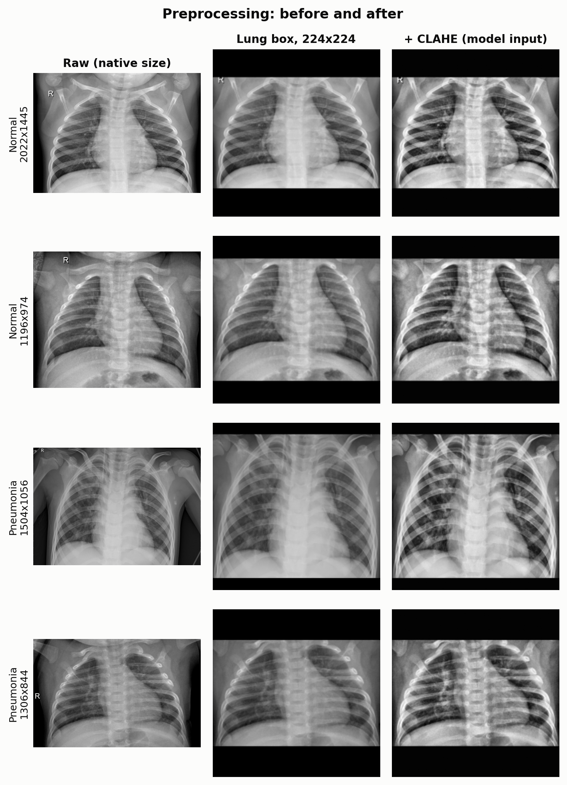

# Lung-box ablation: does cropping to the lungs remove the framing shortcut?

**Question.** The centre-crop ablation (`results/ablation_crop/REPORT.md`) found that removing the aspect-ratio squash does not remove the size shortcut. How the lungs sit in the model input still predicts the label: the top edge of the lungs alone gives test ROC-AUC 0.887, and lungs touching the crop edge give 0.777. Pneumonia X-rays are framed more tightly around the lungs. This ablation crops every X-ray to its lungs: a U-Net finds them, and their bounding box plus a 5% margin is cut out, padded to a square with black and resized to 224x224. Then it retrains and compares with both earlier pipelines.

## Short answer

{{SHORT_ANSWER}}

## Setup

| | `squash` (default, all Review-I/II results) | `crop` (first ablation) | `lungbox` (this ablation) |
|---|---|---|---|
| Geometric step | whole image resized to 224x224 | central square resized to 224x224 | U-Net lung box + 5% margin per side, centred on a black square, resized to 224x224 |
| Kept outside the lungs | everything | the central square | only the 5% margin |
| Everything else | grayscale -> INTER_AREA -> CLAHE (2.0, 8x8) -> RGB | identical | identical |
| Splits | `splits/binary` | `splits/ablation_crop/binary` | `splits/ablation_lungbox/binary`: same 4,658 / 583 / 583 images and patients (checked row by row) |
| Training | `src.train --task binary`, seed 42 | same, `XRAY_PREPROCESS=crop` | same, `XRAY_PREPROCESS=lungbox` |

The variant lives in `fit_to_input` in `src/data/preprocessing.py`. If the U-Net finds no lungs (under 1% of the image), it falls back to the centre square. That never happened: 0 of the 5,824 Kermany images and 0 of the 2,400 COVID-QU-Ex images. {{SELECTION}}

**Why the box is padded with black, not widened into the image.** I first widened the box to a square using the surrounding image and used black only where the square left the image. A smoke test on 160 test images showed this adds a new framing cue. Pneumonia lungs fill the image height, so their squares ran off the top and bottom: black covered 22% of the input for pneumonia against 7% for normal, with bars at the top and bottom only for pneumonia. Cutting out just the box and padding that gives similar bars for both classes, because their size depends only on the lung box's aspect ratio. That ratio is anatomy, and it barely differs by class (median 1.35 vs 1.36 on the test set).

## 0. The lung segmenter

`src/lung_segmenter.py`: a U-Net with 8-16-32-64-128 filters (487,881 parameters) on 256x256 grayscale inputs, trained on the COVID-QU-Ex lung masks. It used BCE + soft Dice loss and Adam 1e-3, with 5 epochs of 400 batches of 16, about 1.6 passes over the training images. The epoch was picked on Val Dice (0.971, epoch 5). A 16-filter version took 2.2 s per batch on this CPU, about 2.6 hours, so I used the smaller one. A bounding box needs only a coarse mask.

Two groups never reached training or validation: the COVID-QU-Ex copies of Kermany val/test images (1,042) and the 2,400 COVID-QU-Ex images of the cross-dataset test. So the segmenter has not seen any image this ablation evaluates on. That left 19,488 Train and 4,904 Val images. Copies of Kermany *train* images stayed in, so the U-Net has seen the pediatric Kermany style.

| Images (`segmenter/dice.md`) | n | Dice (mean) | Dice (median) | Lung-box IoU |
|---|---|---|---|---|
| COVID-QU-Ex Test folder, all | 6,788 | 0.969 | 0.978 | 0.962 |
| ... Normal / COVID-19 / Non-COVID | 2,140 / 2,395 / 2,253 | 0.982 / 0.971 / 0.956 | | 0.975 / 0.966 / 0.946 |
| Held out: copies of the Kermany test images | 517 | 0.956 | 0.963 | 0.961 |
| Held out: the cross-dataset COVID-QU-Ex images | 2,400 | 0.972 | 0.981 | 0.961 |

On the native-size Kermany test images, the U-Net box overlaps the box of the COVID-QU-Ex mask with IoU 0.967 (normal) and 0.956 (pneumonia). The crop keeps a median 100% of the true lung pixels (lowest 99.0% on test, 86.6% on train; `comparison/lungbox_quality.md`).



## 1. Test metrics (held-out Kermany test split, n = 583)

{{TEST_METRICS}}

## 2. Size and framing probes

Logistic regression on geometry only, no pixels, trained on the train split and scored on the test split (`comparison/size_probe.md`). The lung features use the real COVID-QU-Ex masks (4,130 train and 517 test images), mapped through each pipeline's geometric step.

| Features | Test ROC-AUC |
|---|---|
| Native width + height + aspect ratio (Review-I probe) | 0.912 |
| Crop side only (all the size left after centre-cropping) | 0.912 |
| Lung area + lung bounding box in the **squash** input | 0.937 |
| Lung area + lung bounding box in the **crop** input | 0.927 |
| Lung area + lung bounding box in the **lungbox** input | **0.666** |
| Lung-box size in native pixels only (the resolution left after cropping to the lungs) | **0.884** |
| Black areas only (letterbox share + margin past each image edge) | 0.736 |
| Lung-box size + black areas | 0.919 |
| Lungbox: lung framing + lung-box size + black areas | 0.923 |

Per feature (`comparison/lung_framing.md`, test ROC-AUC of the feature alone):

| Feature | squash | crop | lungbox |
|---|---|---|---|
| Top edge of the lungs | 0.887 | 0.887 | **0.519** |
| Bottom edge | 0.734 | 0.527 | 0.539 |
| Left edge | 0.559 | 0.777 | 0.597 |
| Right edge | 0.607 | 0.698 | 0.616 |
| Lung area | 0.612 | 0.709 | 0.596 |

So the lung box does what it is meant to do: the lungs sit in the same place in every input, and the top-edge and edge-contact cues are gone. Two cues are left:

- **Resolution.** The lung box spans a median 1,396 native pixels in normal test images and 937 in pneumonia ones. Both are scaled to 224 pixels, so pneumonia images are shrunk less (about 4x against 6x) and keep a different level of fine detail and noise. The box size alone gives AUC 0.884, almost as much as the full Review-I size probe. No crop can remove this cue; only resampling every image to a common resolution could.
- **A thin black strip where the 5% margin runs past the image edge.** This happens in 212 of 425 pneumonia test images against 11 of 158 normal ones, because pneumonia lungs reach the image top and bottom. The strip is small (1.6% of the input on average for pneumonia, 0.15% for normal), but alone it gives AUC 0.65 (top or bottom).

## 3. Grad-CAM heat inside the lungs

{{GRADCAM}}

## 4. Unseen COVID-QU-Ex Normal / Non-COVID images (n = 2,400)

{{CROSS}}

## Limits

- **One training run per pipeline (seed 42, CPU).** A 1-2 point difference can come from training noise alone. The paired tests treat each trained model as fixed.
- **Grad-CAM is coarse.** ResNet50's last feature map is 7x7, so each cell covers 32x32 input pixels. Heat shares close to the area share mean diffuse maps, not proven lung or non-lung evidence.
- **The segmenter is part of the pipeline.** Its boxes are close to the mask boxes (IoU about 0.96), but a box error moves the crop. The segmenter was trained on COVID-QU-Ex, which also contains copies of the Kermany training images, so its boxes on Kermany train images may be a little better than on new images.
- **The masks are borrowed.** Real lung masks exist for 517 of the 583 test images; the other 66 are left out of the lung rows.

## What would test the shortcut further

- Resample every image to a common pixel scale before cropping (e.g. scale the lung box to a fixed native width first and blur to a common sharpness), to break the resolution cue that this crop leaves.
- Use a margin that never runs past the image (shrink it where the lungs touch the edge), or fill it with a constant for every image, to remove the black-strip cue.
- Evaluate on an external pediatric dataset that no model has seen.

## Default pipeline unchanged (checked {{DATE}})

{{UNCHANGED}}

## Reproduce

```bash
.venv/Scripts/python -m src.lung_segmenter                                # ~35 min on CPU -> models/lung_segmenter/
XRAY_PREPROCESS=lungbox .venv/Scripts/python -m src.data.prepare         # ~17 min (U-Net on every image)
XRAY_PREPROCESS=lungbox .venv/Scripts/python -m src.train --task binary  # ~60 min on CPU
XRAY_PREPROCESS=lungbox .venv/Scripts/python -m src.gradcam
.venv/Scripts/python -m src.ablation_lungbox                             # {{CMP_TIME}}; writes comparison/
```

Files: `segmenter/` (Dice, training history), `comparison/*.md` (tables), `comparison/comparison.json` (all numbers), `comparison/gradcam_per_image.csv` (per image; squash and crop rows come from the crop ablation, and a sample of them is recomputed and checked), `comparison/lungbox_geometry.csv` (lung box per Kermany image), the training outputs and `gradcam/` in this folder, and logs in `logs/`.
