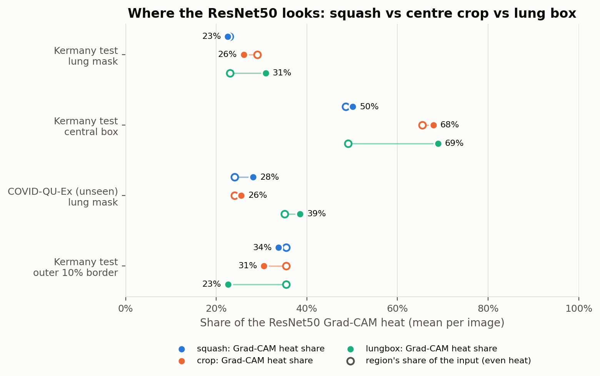
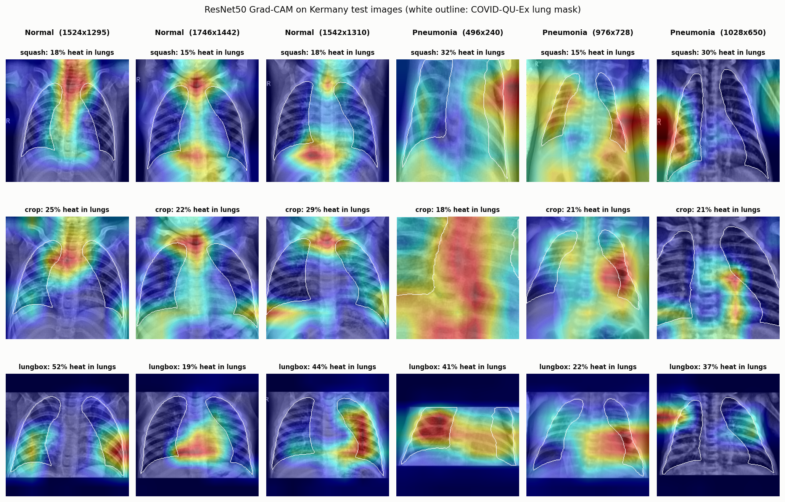

# Lung-box ablation: does cropping to the lungs remove the framing shortcut?

**Question.** The centre-crop ablation (`results/ablation_crop/REPORT.md`) found that removing the aspect-ratio squash does not remove the size shortcut. How the lungs sit in the model input still predicts the label: the top edge of the lungs alone gives test ROC-AUC 0.887, and lungs touching the crop edge give 0.777. Pneumonia X-rays are framed more tightly around the lungs. This ablation crops every X-ray to its lungs: a U-Net finds them, and their bounding box plus a 5% margin is cut out, padded to a square with black and resized to 224x224. Then it retrains and compares with both earlier pipelines.

## Short answer

1. **Accuracy drops more than with the centre crop.** ResNet50 falls from 95.7% (squash) to 90.9% on the same 583 test images (-4.8 points, 95% CI -7.2 to -2.7, McNemar p = 0.0001), and to 2.7 points below the crop (p = 0.037). Unlike the crop, the ranking gets worse too: ROC-AUC goes from 0.993 to 0.965 for ResNet50 and from 0.986 to 0.963 for the baseline CNN. Part of what the models used was outside the lung box.
2. **The framing cue is gone; the resolution cue is not.**
   - Where the lungs sit in the input now predicts the label with AUC 0.666, against 0.937 (squash) and 0.927 (crop). The top edge of the lungs falls from 0.887 to 0.519, chance level.
   - The lung box's size in native pixels still gives AUC 0.884 on its own. A thin black strip where the 5% margin runs past the image edge (half of the pneumonia images) adds a small cue (0.65).
3. **ResNet50's Grad-CAM moves onto the lungs.** 30.9% of its heat falls inside the lung masks, which cover 23.0% of the input (squash: 22.5% on 22.9%; crop: 26.1% on 29.0%), +8.4 points against squash. The border band gets 22.6% of the heat on 35.4% of the input. The baseline CNN does not follow (16.0% on 23.0%).
4. **Unseen COVID-QU-Ex: ResNet50 gets worse, the baseline CNN gets better.** ResNet50 drops from 73.9% to 67.5% (specificity 0.58 to 0.41). The baseline CNN rises to 77.7% (AUC 0.862), the best of the six models.

**Verdict.** Cropping to the lungs removes the framing shortcut that the centre crop left, and that costs about 5 points of accuracy and 0.03 of ROC-AUC on Kermany. So some of the default pipeline's 95.7% came from outside the lungs: framing, collimation and markers. The ResNet50 now looks more at the lungs, but it does not generalise better. On COVID-QU-Ex it calls most normal images pneumonia, which fits a model that still uses the resolution cue. Removing that cue would take resampling to a common pixel scale, not cropping. The default squash pipeline stays the default, and the lung box is kept as an option (`XRAY_PREPROCESS=lungbox`, which needs `models/lung_segmenter/`).

## Setup

| | `squash` (default, all Review-I/II results) | `crop` (first ablation) | `lungbox` (this ablation) |
|---|---|---|---|
| Geometric step | whole image resized to 224x224 | central square resized to 224x224 | U-Net lung box + 5% margin per side, centred on a black square, resized to 224x224 |
| Kept outside the lungs | everything | the central square | only the 5% margin |
| Everything else | grayscale -> INTER_AREA -> CLAHE (2.0, 8x8) -> RGB | identical | identical |
| Splits | `splits/binary` | `splits/ablation_crop/binary` | `splits/ablation_lungbox/binary`: same 4,658 / 583 / 583 images and patients (checked row by row) |
| Training | `src.train --task binary`, seed 42 | same, `XRAY_PREPROCESS=crop` | same, `XRAY_PREPROCESS=lungbox` |

The variant lives in `fit_to_input` in `src/data/preprocessing.py`. If the U-Net finds no lungs (under 1% of the image), it falls back to the centre square. That never happened: 0 of the 5,824 Kermany images and 0 of the 2,400 COVID-QU-Ex images. On validation F1, all three pipelines select ResNet50: 0.962 for squash, 0.954 for crop, 0.941 for lungbox.

**Why the box is padded with black, not widened into the image.** I first widened the box to a square using the surrounding image and used black only where the square left the image. A smoke test on 160 test images showed this adds a new framing cue. Pneumonia lungs fill the image height, so their squares ran off the top and bottom: black covered 22% of the input for pneumonia against 7% for normal, with bars at the top and bottom only for pneumonia. Cutting out just the box and padding that gives similar bars for both classes, because their size depends only on the lung box's aspect ratio. That ratio is anatomy, and it barely differs by class (median 1.35 vs 1.36 on the test set).

## 0. The lung segmenter

`src/lung_segmenter.py`: a U-Net with 8-16-32-64-128 filters (487,881 parameters) on 256x256 grayscale inputs, trained on the COVID-QU-Ex lung masks. It used BCE + soft Dice loss and Adam 1e-3, with 5 epochs of 400 batches of 16, about 1.6 passes over the training images. The epoch was picked on Val Dice (0.971, epoch 5). A 16-filter version took 2.2 s per batch on this CPU, about 2.6 hours, so I used the smaller one. A bounding box needs only a coarse mask.

Two groups never reached training or validation: the COVID-QU-Ex copies of Kermany val/test images (1,042) and the 2,400 COVID-QU-Ex images of the cross-dataset test. So the segmenter has not seen any image this ablation evaluates on. That left 19,488 Train and 4,904 Val images. Copies of Kermany *train* images stayed in, so the U-Net has seen the pediatric Kermany style.

| Images (`segmenter/dice.md`) | n | Dice (mean) | Dice (median) | Lung-box IoU |
|---|---|---|---|---|
| COVID-QU-Ex Test folder, all | 6,788 | 0.969 | 0.978 | 0.962 |
| ... Normal / COVID-19 / Non-COVID | 2,140 / 2,395 / 2,253 | 0.982 / 0.971 / 0.956 | | 0.975 / 0.966 / 0.946 |
| Held out: copies of the Kermany test images | 517 | 0.956 | 0.963 | 0.961 |
| Held out: the cross-dataset COVID-QU-Ex images | 2,400 | 0.972 | 0.981 | 0.961 |

On the native-size Kermany test images, the U-Net box overlaps the box of the COVID-QU-Ex mask with IoU 0.967 (normal) and 0.956 (pneumonia). The crop keeps a median 100% of the true lung pixels (lowest 99.0% on test, 86.6% on train; `comparison/lungbox_quality.md`).


## 1. Test metrics (held-out Kermany test split, n = 583)

| Model | Preprocessing | Accuracy (95% CI) | Sensitivity | Specificity | F1 | ROC-AUC | FP | FN |
|---|---|---|---|---|---|---|---|---|
| ResNet50 | squash | 95.7% (93.7-97.1) | 0.969 | 0.924 | 0.971 | 0.993 | 12 | 13 |
| ResNet50 | crop | 93.7% (91.4-95.4) | 0.944 | 0.918 | 0.956 | 0.989 | 13 | 24 |
| ResNet50 | **lungbox** | **90.9% (88.3-93.0)** | 0.929 | 0.854 | 0.937 | **0.965** | 23 | 30 |
| Baseline CNN | squash | 94.2% (92.0-95.8) | 0.988 | 0.817 | 0.961 | 0.986 | 29 | 5 |
| Baseline CNN | crop | 89.7% (87.0-91.9) | 0.861 | 0.994 | 0.924 | 0.990 | 1 | 59 |
| Baseline CNN | **lungbox** | **91.4% (88.9-93.4)** | 0.897 | 0.962 | 0.938 | **0.963** | 6 | 44 |

Paired on the same images (lungbox minus the other pipeline; CIs from 2,000 patient-level bootstrap resamples):

| Model | Comparison | Accuracy change (95% CI) | Only the other right / only lungbox right | McNemar p | ROC-AUC change (95% CI) | Same prediction |
|---|---|---|---|---|---|---|
| ResNet50 | lungbox vs squash | -4.8 points (-7.2 to -2.7) | 38 / 10 | 0.0001 | -0.028 (-0.042 to -0.017) | 91.8% |
| ResNet50 | lungbox vs crop | -2.7 points (-5.2 to -0.4) | 34 / 18 | 0.037 | -0.023 (-0.036 to -0.013) | 91.1% |
| Baseline CNN | lungbox vs squash | -2.7 points (-5.8 to +0.2) | 43 / 27 | 0.072 | -0.023 (-0.037 to -0.010) | 88.0% |
| Baseline CNN | lungbox vs crop | +1.7 points (-0.5 to +3.8) | 16 / 26 | 0.16 | -0.027 (-0.039 to -0.015) | 92.8% |

Unlike the crop, the lung box does not just shift the threshold. ROC-AUC falls for both models (ResNet50 0.993 to 0.965, baseline 0.986 to 0.963), and every AUC interval excludes zero. The models rank the test images worse once the framing is gone.

ResNet50 accuracy per subtype (`comparison/subtype_accuracy.md`):

| Subtype | n | squash | crop | lungbox |
|---|---|---|---|---|
| Bacterial pneumonia | 276 | 98.2% | 96.7% | 96.4% |
| Viral pneumonia | 149 | 94.6% | 89.9% | 86.6% |
| Normal | 158 | 92.4% | 91.8% | 85.4% |

Viral pneumonia, the subtle cases, loses most again, and normal images now lose as much (23 false alarms, against 12-13 before).

## 2. Size and framing probes

Logistic regression on geometry only, no pixels, trained on the train split and scored on the test split (`comparison/size_probe.md`). The lung features use the real COVID-QU-Ex masks (4,130 train and 517 test images), mapped through each pipeline's geometric step.

| Features | Test ROC-AUC |
|---|---|
| Native width + height + aspect ratio (Review-I probe) | 0.912 |
| Crop side only (all the size left after centre-cropping) | 0.912 |
| Lung area + lung bounding box in the **squash** input | 0.937 |
| Lung area + lung bounding box in the **crop** input | 0.927 |
| Lung area + lung bounding box in the **lungbox** input | **0.666** |
| Lung-box size in native pixels only (the resolution left after cropping to the lungs) | **0.884** |
| Black areas only (letterbox share + margin past each image edge) | 0.736 |
| Lung-box size + black areas | 0.919 |
| Lungbox: lung framing + lung-box size + black areas | 0.923 |

Per feature (`comparison/lung_framing.md`, test ROC-AUC of the feature alone):

| Feature | squash | crop | lungbox |
|---|---|---|---|
| Top edge of the lungs | 0.887 | 0.887 | **0.519** |
| Bottom edge | 0.734 | 0.527 | 0.539 |
| Left edge | 0.559 | 0.777 | 0.597 |
| Right edge | 0.607 | 0.698 | 0.616 |
| Lung area | 0.612 | 0.709 | 0.596 |

So the lung box does what it is meant to do: the lungs sit in the same place in every input, and the top-edge and edge-contact cues are gone. Two cues are left:

- **Resolution.** The lung box spans a median 1,396 native pixels in normal test images and 937 in pneumonia ones. Both are scaled to 224 pixels, so pneumonia images are shrunk less (about 4x against 6x) and keep a different level of fine detail and noise. The box size alone gives AUC 0.884, almost as much as the full Review-I size probe. No crop can remove this cue; only resampling every image to a common resolution could.
- **A thin black strip where the 5% margin runs past the image edge.** This happens in 212 of 425 pneumonia test images against 11 of 158 normal ones, because pneumonia lungs reach the image top and bottom. The strip is small (1.6% of the input on average for pneumonia, 0.15% for normal), but alone it gives AUC 0.65 (top or bottom).

## 3. Grad-CAM heat inside the lungs

The measure is the one used in the crop ablation. It is the share of the predicted-class Grad-CAM heat, upsampled to 224x224, that falls inside a region of the model input, compared with the region's share of the input. The regions are the COVID-QU-Ex lung masks (517 Kermany test images, all 2,400 COVID-QU-Ex images), the native central box (15-85% of width and height) and the outer 10% border band, each mapped through each pipeline's own geometric step. The squash and crop rows are the crop ablation's per-image rows: 12 images per dataset, model and pipeline were recomputed and matched.

ResNet50 (paired differences; 95% CIs from patient or cluster bootstrap; Wilcoxon signed-rank p):

| Region | Images | Squash: heat (area) | Crop: heat (area) | Lungbox: heat (area) | Lungbox - squash | Lungbox - crop |
|---|---|---|---|---|---|---|
| Kermany test, lung mask | 517 | 22.5% (22.9%) | 26.1% (29.0%) | **30.9% (23.0%)** | +8.4 points (+7.5 to +9.2), p < 1e-60 | +4.9 (+4.0 to +5.7), p < 1e-29 |
| Kermany test, central box | 583 | 50.1% (48.6%) | 68.0% (65.5%) | 69.0% (49.1%) | +18.8 (+17.5 to +20.0) | +1.0 (-0.4 to +2.7), p = 0.28 |
| Kermany test, outer 10% border | 583 | 33.8% (35.4%) | 30.5% (35.4%) | **22.6% (35.4%)** | -11.2 (-12.0 to -10.2) | -7.9 (-9.0 to -7.1) |
| ... pneumonia images only | 425 | 38.2% (35.4%) | 30.1% (35.4%) | 24.9% (35.4%) | | |
| COVID-QU-Ex unseen, lung mask | 2,398 | 28.2% (24.0%) | 25.5% (24.0%) | 38.5% (35.1%) | +10.3 (+9.7 to +11.0) | +13.0 (+12.6 to +13.4) |
| COVID-QU-Ex unseen, outer 10% border | 2,398 | 26.9% (35.4%) | 27.6% (35.4%) | 26.4% (35.4%) | -0.5 (-1.2 to +0.1) | -1.2 (-1.8 to -0.6) |

(2 COVID-QU-Ex images have an all-zero lungbox Grad-CAM map and are left out of the heat rows.)

For the first time, ResNet50 puts more heat in the lungs than their area: heat-to-area ratio 1.34, against 0.98 (squash) and 0.90 (crop). It also puts much less in the border band (22.6% on 35.4% of the input). On Kermany the lungs fill about the same share of the input as with squash (23.0% vs 22.9%), so this is a real shift, not just bigger lungs. On COVID-QU-Ex the lungs fill more of the lungbox input (35.1% against 24.0%), and the ratio is 1.10, between squash (1.17) and crop (1.06).

The baseline CNN does not follow. Its Kermany lung share is 16.0% for 23.0% of the area (ratio 0.70), the same as the crop's 15.9% and lower than squash (22.4%). Its COVID-QU-Ex lung share rises to 30.6%, but for 35.1% of the area (`comparison/gradcam_heat.md`).





In the examples, squash and crop heat often sits on the neck, the mediastinum and the "R" marker. Lungbox heat sits mostly on the lung fields and the heart border, though some maps still reach outside the lungs.

## 4. Unseen COVID-QU-Ex Normal / Non-COVID images (n = 2,400)

These 256x256 images go through each pipeline's own geometric step. Squash and crop give them identical inputs; lungbox crops them to the U-Net lung box like the Kermany images.

| Model | Preprocessing | Accuracy (95% CI) | Sensitivity | Specificity | ROC-AUC |
|---|---|---|---|---|---|
| ResNet50 | squash | 73.9% (72.1-75.6) | 0.897 | 0.581 | 0.873 |
| ResNet50 | crop | 74.0% (72.2-75.7) | 0.868 | 0.612 | 0.850 |
| ResNet50 | **lungbox** | **67.5% (65.6-69.4)** | 0.944 | **0.407** | 0.857 |
| Baseline CNN | squash | 55.5% (53.5-57.4) | 0.974 | 0.135 | 0.784 |
| Baseline CNN | crop | 75.3% (73.5-77.0) | 0.794 | 0.712 | 0.833 |
| Baseline CNN | **lungbox** | **77.7% (76.0-79.3)** | 0.750 | 0.804 | **0.862** |

Paired accuracy change on the same images: ResNet50 -6.3 points against squash (-8.0 to -4.6, McNemar p < 1e-12) and -6.5 against crop; baseline CNN +22.2 against squash and +2.4 against crop (+1.0 to +3.9, p = 0.002).

The lungbox ResNet50 calls 59% of the unseen *normal* images pneumonia. One likely reason is the resolution cue from section 2. COVID-QU-Ex images are 256 pixels wide, so their lung boxes are about 200 pixels: as small as the smallest Kermany pneumonia images, and smaller than any Kermany normal image (minimum 760 pixels). With the framing cues gone, a model that leans on resolution would read every COVID-QU-Ex image as pneumonia-like. This fits the data, but it is not tested here. The baseline CNN is the only model that improves on the unseen set, and it is now the best of the six (AUC 0.862).

These images are unseen by the binary models and the segmenter. The 4-class model the app serves was trained on 1,920 of them.

## Limits

- **One training run per pipeline (seed 42, CPU).** A 1-2 point difference can come from training noise alone. The paired tests treat each trained model as fixed.
- **Grad-CAM is coarse.** ResNet50's last feature map is 7x7, so each cell covers 32x32 input pixels. Heat shares close to the area share mean diffuse maps, not proven lung or non-lung evidence.
- **The segmenter is part of the pipeline.** Its boxes are close to the mask boxes (IoU about 0.96), but a box error moves the crop. The segmenter was trained on COVID-QU-Ex, which also contains copies of the Kermany training images, so its boxes on Kermany train images may be a little better than on new images.
- **The masks are borrowed.** Real lung masks exist for 517 of the 583 test images; the other 66 are left out of the lung rows.

## What would test the shortcut further

- Resample every image to a common pixel scale before cropping (e.g. scale the lung box to a fixed native width first and blur to a common sharpness), to break the resolution cue that this crop leaves.
- Use a margin that never runs past the image (shrink it where the lungs touch the edge), or fill it with a constant for every image, to remove the black-strip cue.
- Evaluate on an external pediatric dataset that no model has seen.

## Default pipeline unchanged (checked 2026-10-16)

- The served `models/best_model.keras` (4-class ResNet50), `models/binary/*`, `models/multiclass/*`, the chest gate and the crop-ablation models are byte-identical to before this ablation (SHA-256).
- `preprocess_gray()` still reproduces all 5,824 stored `squash` images in `data/preprocessed/kermany` and all 5,824 `crop` images bit for bit, after `fit_to_input` was extended for the new variant.
- Since the crop-ablation commit (4ab1096), files under `results/` and `splits/` have only been added (this ablation and the TBX11K external test); none was modified or deleted.
- `tests/test_integration.py` passes.

## Reproduce

```bash
.venv/Scripts/python -m src.lung_segmenter                                # ~35 min on CPU -> models/lung_segmenter/
XRAY_PREPROCESS=lungbox .venv/Scripts/python -m src.data.prepare         # ~17 min (U-Net on every image)
XRAY_PREPROCESS=lungbox .venv/Scripts/python -m src.train --task binary  # ~60 min on CPU
XRAY_PREPROCESS=lungbox .venv/Scripts/python -m src.gradcam
.venv/Scripts/python -m src.ablation_lungbox --prepare-only              # optional, ~12 min: U-Net part, can run during training
.venv/Scripts/python -m src.ablation_lungbox                             # ~13 min after --prepare-only (~25 without); writes comparison/
```

Files: `segmenter/` (Dice, training history), `comparison/*.md` (tables), `comparison/comparison.json` (all numbers), `comparison/gradcam_per_image.csv` (per image; squash and crop rows come from the crop ablation, and a sample of them is recomputed and checked), `comparison/lungbox_geometry.csv` (lung box per Kermany image), the training outputs and `gradcam/` in this folder, and logs in `logs/`.
