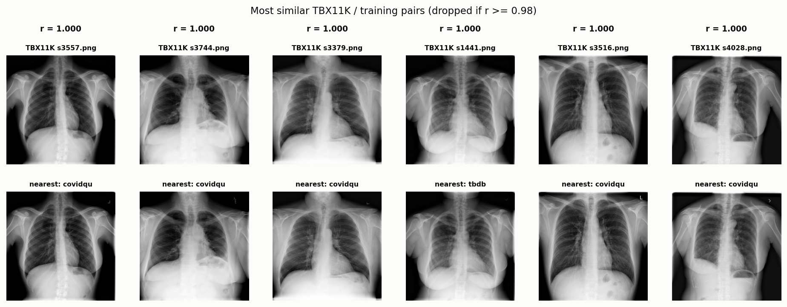
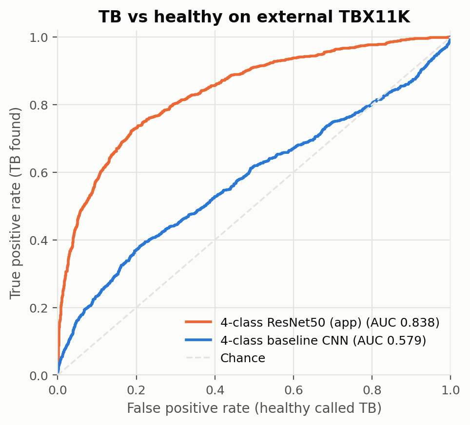

# External test on TBX11K: do the models work on X-rays from a new source?

**Question.** Every result so far comes from held-out images of the *same* datasets the models were trained on. This test uses TBX11K (Liu et al., CVPR 2020; Kaggle `vbookshelf/tbx11k-simplified`, CC BY 4.0). No model was trained on it. It contains 512x512 chest X-rays labelled healthy, sick but not TB, or TB (active or latent).

**Why not Shenzhen, Montgomery or RSNA.** They are already inside the training data, so they cannot be an external test. The TB database's README lists 394 TB and 406 normal images "from NLM" (Shenzhen + Montgomery: 800 images, the full size of the two sets), plus 3,094 normal images from RSNA.

## Short answer

1. **The TB class does not transfer.** On its own held-out test split, the app's 4-class ResNet50 found 94.3% of TB images (AUC 0.999). On TBX11K it finds **5.8%** (AUC 0.838). External TB images are mostly called Normal (59%) or COVID-19 (30%). The Review-II TB score was mostly a dataset shortcut: all training TB came from one database, as the Review-II README had warned.
2. **Healthy adults are handled well.** 92.9% are called Normal. The non-chest gate passes 99.5-100% of the external X-rays in every group (it rejects 0.5% of "sick, not TB" and none of the rest).
3. **The models notice that something is abnormal, but not what.** Read as "any finding vs healthy", all three models reach AUC about 0.85. The app model flags 63% of "sick, not TB" images, but half of all those images are called COVID-19.
4. **The binary Kermany model raises false alarms on adults.** It calls 12.3% of healthy adults pneumonia (it was trained on children).

## Duplicate check first

Each TBX11K image was compared with every raw image of the three training sources: 43,976 images (Kermany 5,856, COVID-QU-Ex 33,920, TB database 4,200), including images the training never used. The comparison uses the Phase 3 near-duplicate test: 32x32 thumbnail correlation, dropped at r >= 0.98.

| | Images |
|---|---|
| TBX11K labelled images (one row per image) | 8,399 |
| Dropped as copies of training images (35 COVID-QU-Ex, 11 TB database; 45 "sick, not TB", 1 healthy) | 46 |
| **Used** (healthy 3,799 · sick, not TB 3,755 · active TB 651 · latent TB 148) | **8,353** |

At 32x32 all chest X-rays look alike (median r 0.92), so every borderline pair was recomputed at 128x128 (`duplicate_recheck.json`):
- **The 46 dropped pairs are true copies.** They stay at r >= 0.994 (median 0.999); the six shown in `nearest_training_pairs.png` are pixel-identical.
- **The 689 kept images at 0.95-0.98 are different people.** They drop to r <= 0.963 (median 0.940), and the closest three, checked by eye, show different anatomy.



The 3,302 unlabelled images in TBX11K's `test` folder are not used.

## TB detection (the two 4-class models; 95% CIs)

| Model | TB found (all) | Active | Latent | Healthy called TB | P(TB) AUC, TB vs healthy | Same model, held-out test of training sources |
|---|---|---|---|---|---|---|
| ResNet50 (app) | **5.8%** (4.3-7.6) | 6.3% | 3.4% | 0.2% | 0.838 (0.822-0.853) | 94.3% / AUC 0.999 |
| Baseline CNN | 0.4% (0.1-1.1) | 0.3% | 0.7% | 0.0% | 0.579 (0.555-0.602) | 64.3% / AUC 0.997 |



The ResNet50's TB probability still ranks TB images above healthy ones (AUC 0.838), so it carries some TB signal. But that probability almost never beats the other classes, so TB is almost never the predicted class.

## What each model calls each kind of image

| Model | TBX11K images | Normal | Pneumonia | COVID-19 | TB |
|---|---|---|---|---|---|
| ResNet50 (app) | Healthy (3,799) | **92.9%** | 0.3% | 6.7% | 0.2% |
| | Sick, not TB (3,755) | 37.0% | 11.9% | 49.1% | 2.0% |
| | Active TB (651) | 59.3% | 4.3% | 30.1% | 6.3% |
| | Latent TB (148) | 62.2% | 4.1% | 30.4% | 3.4% |
| Baseline CNN | Healthy | 55.4% | 0.4% | 44.1% | 0.0% |
| | Sick, not TB | 7.5% | 0.9% | 91.5% | 0.1% |
| Binary ResNet50 (Kermany) | Healthy | 87.7% | 12.3% | - | - |
| | Sick, not TB | 25.9% | 74.1% | - | - |
| | Active / latent TB | 55.3% / 50.7% | 44.7% / 49.3% | - | - |

Any finding vs healthy, using 1 - P(Normal) as the score (`any_finding.md`):

| Model | Healthy flagged | Sick, not TB flagged | TB flagged | AUC |
|---|---|---|---|---|
| ResNet50 (app) | 7.1% | 63.0% | 40.2% | 0.856 (0.849-0.864) |
| Baseline CNN | 44.6% | 92.5% | 64.3% | 0.851 (0.843-0.859) |
| Binary ResNet50 (Kermany) | 12.3% | 74.1% | 45.6% | 0.848 (0.840-0.856) |

## What this means

- **The app's TB result should not be trusted on X-rays from other hospitals.** Its held-out AUC of 0.999 measured recognition of the TB database, not detection of TB.
- **Its Normal class is the most dependable output on new data.**
- **Fixing TB means training on several TB sources and testing on one never trained on.** For example: the TB database plus the TBX11K train split, tested on another external TB set. Until then, the app should show a clear warning for TB predictions.

## Limits

- **One external dataset, from one setting.** TBX11K's "sick, not TB" group mixes many diseases, so only TB and healthy have exact labels here.
- **Latent TB often shows little on an X-ray,** so low sensitivity there is expected for any model.
- **The intervals are per image.** TBX11K has no patient ids, so the 95% intervals are image-level bootstraps (AUC) or Wilson intervals (rates).
- **Every TBX11K image is a 512x512 PNG,** which is a source signature of its own.

## Reproduce

```bash
# dataset (3.2 GB): Kaggle vbookshelf/tbx11k-simplified -> data/raw/tbx11k
.venv/Scripts/python -m src.external_test           # ~30 min on CPU: duplicate check + 3 models
.venv/Scripts/python -m src.external_test --reuse   # rebuild the tables from saved predictions
```

Files: `splits/external/tbx11k.csv` (every image, nearest training image, correlation, kept), `duplicate_check.json`, `duplicate_recheck.json`, `predictions_*.csv`, the tables `*.md` / `*.csv`, and `external_test.json` (all numbers).
